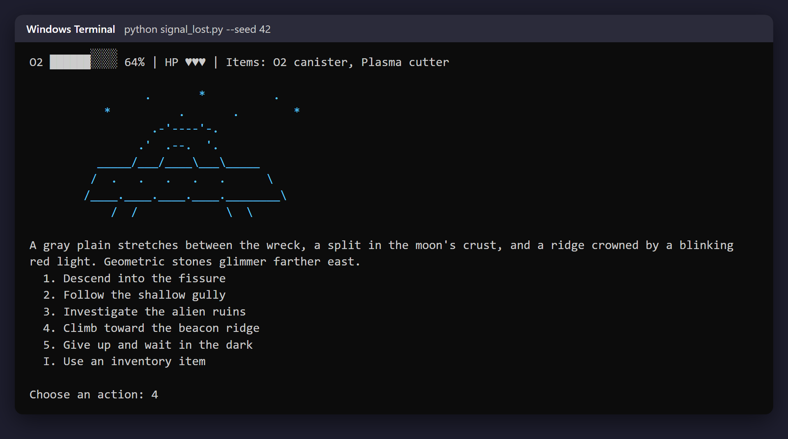
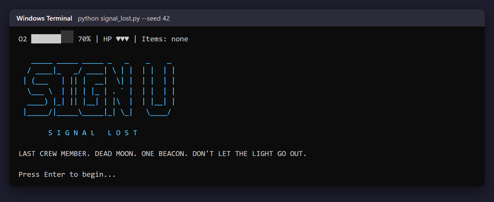
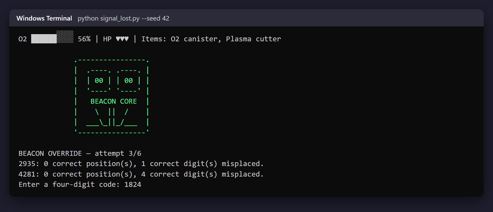
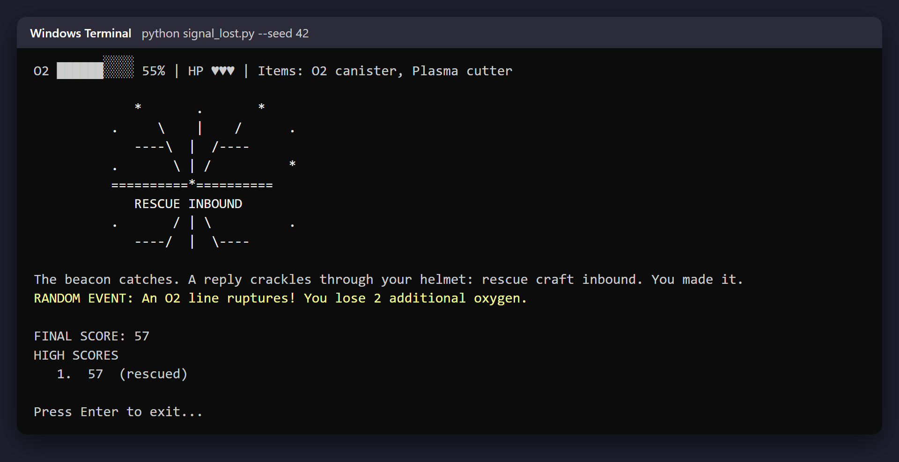

# SIGNAL LOST

A standard-library Python 3 terminal survival game. You are the last crew member
of a cargo ship that crashed on a dead moon. Find a way to restart the distress
beacon before your oxygen runs out.

Built with **GitHub Copilot** (Agent mode in VS Code) for the MLH Global Hack Week:
Hacktoberfest challenge *"Use GitHub Copilot to Build a Simple Application"*.



| Title screen | Beacon hacking puzzle | Rescued ending |
|:---:|:---:|:---:|
|  |  |  |

Screenshots are from a full playthrough with `--seed 42`: cargo hold (plasma cutter + O2
canister) → moon plain → beacon ridge → tower → code cracked on the third guess → rescued, score 57.

## Run

Python 3.10 or newer is recommended.

```powershell
python signal_lost.py
```

Skip the typewriter effect with `--fast`. Pass an integer to `--seed` to replay
the same sequence of random events and the same beacon code:

```powershell
python signal_lost.py --fast --seed 42
```

Run the tests:

```powershell
python -m unittest -v
```

Use the numbered options to explore. Every move costs oxygen; some routes cost
extra. Type `I` when available to use an O2 canister or medkit. Search carefully:
the plasma cutter and alien key unlock new paths. At the tower, guess the
four-digit override code using Mastermind-style feedback; you have six tries.
Your final score is remaining oxygen plus distinct items found, with a 100-point
bonus for the secret alien ending. The top ten scores are stored in
`highscores.json` beside the game script.

## Scene map

```text
Crash Site ── Cargo Hold ── Moon Plain ── Fissure ── Cave ── Alien Ruins
                                │             │                 │
                                ├── Gully ── Wreckage           └─ Archive
                                │
                                └── Beacon Ridge ── Tower Base ── Tower Interior
                                                                   ├─ Rescued
                                                                   └─ Stranded

Moon Plain ── Wait in the dark ── Stranded
Alien Archive ── Answer the signal ── Secret alien ending
Any location ── Oxygen reaches zero ── Oxygen ending
```

The game contains 12 explorable scenes and four endings: rescued, stranded,
secret alien, and oxygen loss.
