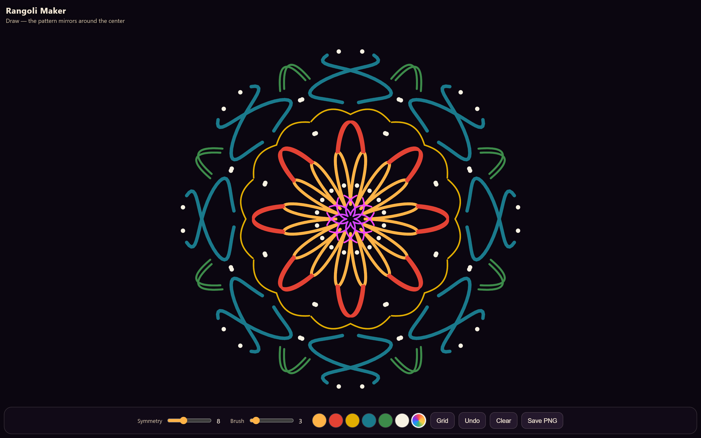

# Rangoli Maker

A single-file kaleidoscope drawing toy for GHW: Hacktoberfest **CHALLENGE 1: Build a Mini App with Cursor**.

Open `index.html` in a browser. There is no build step and no libraries.

More: [with guide grid](screenshots/rangoli-grid.png) · [after Undo](screenshots/rangoli-after-undo.png)

## What it does

Draw with mouse, finger, or stylus. Each stroke is copied around the canvas center with **N-fold rotational symmetry**, then **reflected** in every sector so the pattern behaves like a kaleidoscope.

## Controls

| Control | Detail |
|---------|--------|
| **Symmetry** | 4–16 folds (default 8). Changes new strokes and the guide rays. Existing strokes keep the fold count they were drawn with. |
| **Brush** | Line width, 1–24. |
| **Palette** | Marigold, vermilion, turmeric, peacock blue, leaf green, white. |
| **Rainbow** | Hue walks along the stroke as you draw. |
| **Grid** | Faint concentric rings and radial rays. Off when you save. |
| **Undo** | Drops the last stroke and replays the rest. |
| **Clear** | Empties the canvas. |
| **Save PNG** | Downloads `rangoli.png` (dark background, no UI, no grid). |

## Notes

- Pointer Events cover mouse, touch, and pen. The canvas uses `touch-action: none` so drawing does not scroll the page.
- The backing store is sized with `devicePixelRatio` (capped at 2) so lines stay sharp on phones.
- The toolbar sits above the home-indicator inset on notched devices.

## Challenge

Folder for [MLH Global Hack Week: Hacktoberfest](https://events.mlh.io/events/14553-global-hack-week-hacktoberfest) Cursor Challenge 1.
