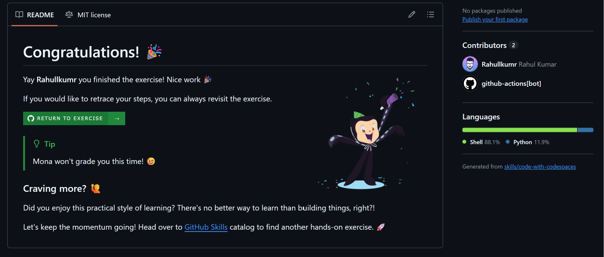

# Code with Codespaces

GitHub Skills exercise for the MLH Global Hack Week: Hacktoberfest challenge *"Code with Codespaces"*.

- **Exercise repo:** [Rahullkumr/skills-code-with-codespaces](https://github.com/Rahullkumr/skills-code-with-codespaces)
- **Progress issue:** [#1 Exercise: Code with Codespaces](https://github.com/Rahullkumr/skills-code-with-codespaces/issues/1) (closed, all steps passed)
- **Pull request:** none (this exercise commits straight to `main` from the codespace)

## What I did

- Created my first codespace from the exercise repo and changed code in the browser-based VS Code.
- Customized the codespace with a dev container configuration tailored to the repository.
- Practiced working in the codespace: running the project, committing, and pushing from the cloud environment.

## Completion

