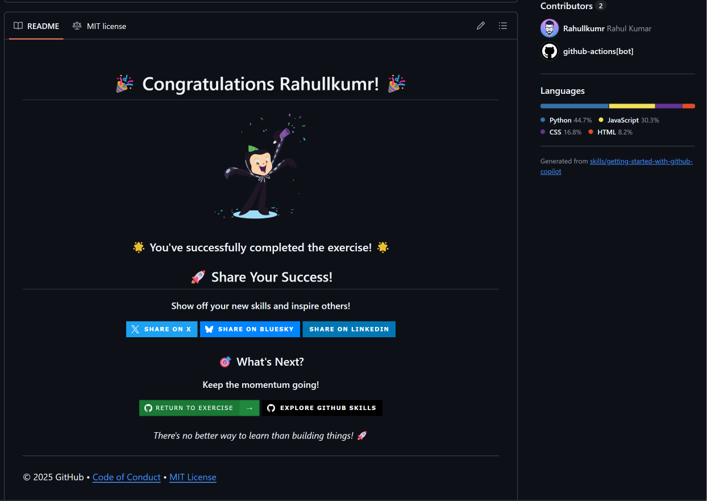

# Getting Started with GitHub Copilot

GitHub Skills exercise for the MLH Global Hack Week: Hacktoberfest challenge *"Getting Started with Copilot"*.

- **Exercise repo:** [Rahullkumr/skills-getting-started-with-github-copilot](https://github.com/Rahullkumr/skills-getting-started-with-github-copilot)
- **Progress issue:** [#1 Exercise: Getting Started with GitHub Copilot](https://github.com/Rahullkumr/skills-getting-started-with-github-copilot/issues/1) (closed, all steps passed)
- **Pull request:** [#2 Improve student activity registration system](https://github.com/Rahullkumr/skills-getting-started-with-github-copilot/pull/2) (merged)

## What I did

Guided Copilot to improve Mergington High School's extracurricular activities website (FastAPI + vanilla JS), working in a Codespace on the `accelerate-with-copilot` branch.

| Step | Copilot feature | Result |
|------|-----------------|--------|
| 1. Hello Copilot | Ask mode, terminal inline chat | Explained the project, ran it, created and published the branch from a terminal prompt |
| 2. Getting work done | Ask mode with `#codebase`, inline suggestions, inline chat, generated commit message | Found and fixed the double-registration bug; added 6 new activities |
| 3. Agent mode | Agent mode with file context and `#codebase` | Participants list on each activity card, delete icon to unregister, fixed the refresh-after-signup bug |
| 4. Planning agent | Plan agent, then Start implementation | Planned and implemented backend `pytest` tests (Arrange-Act-Assert) in a separate `tests/` directory |
| 5. Pull request | GitHub PR flow | Opened and merged the PR into `main` |

## Completion

